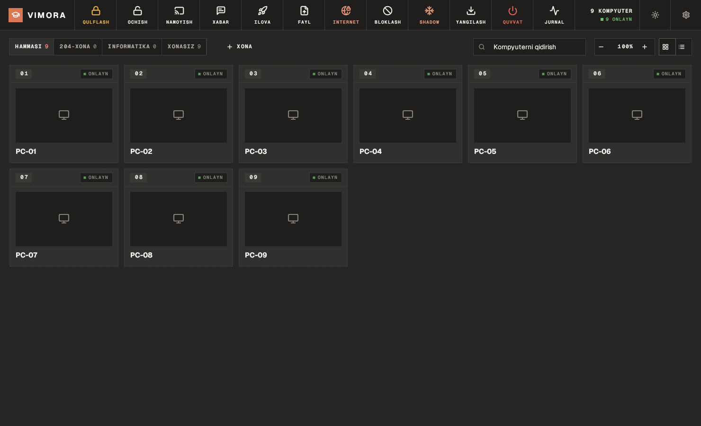
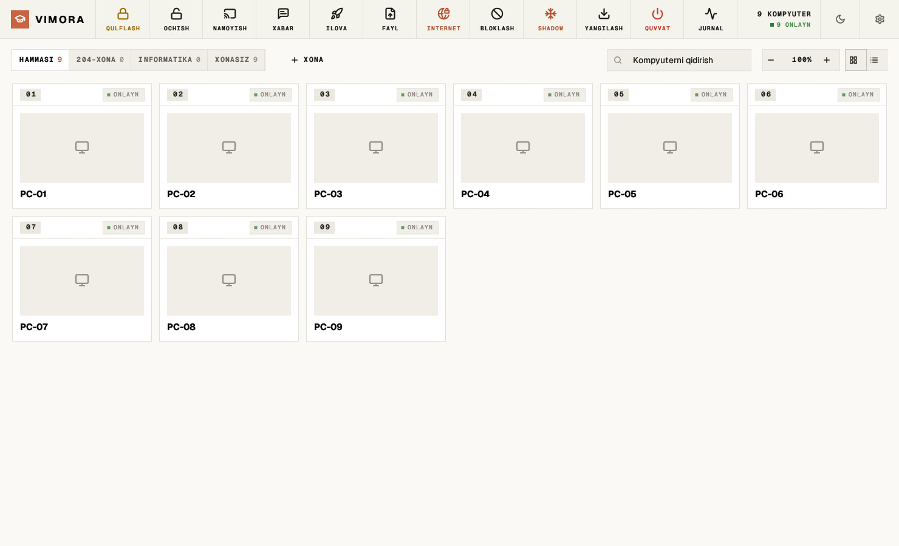
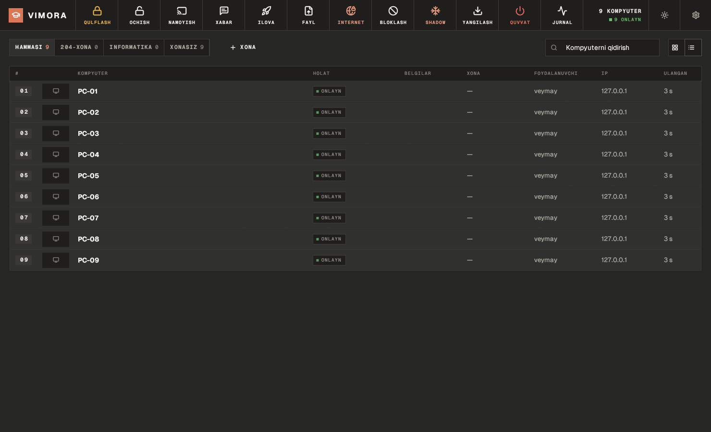
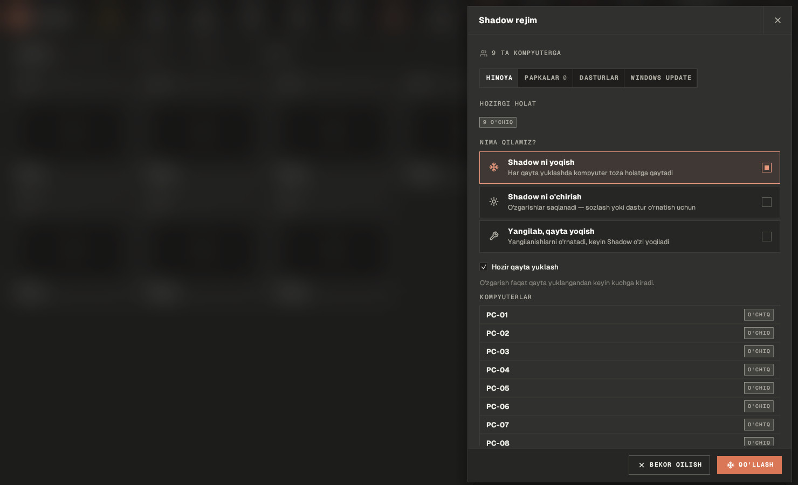
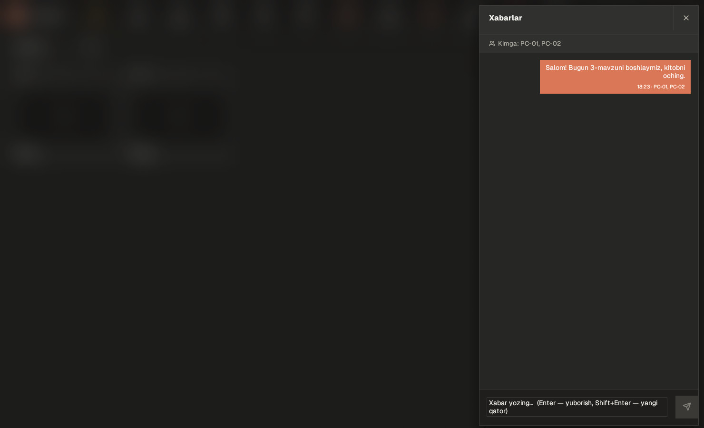
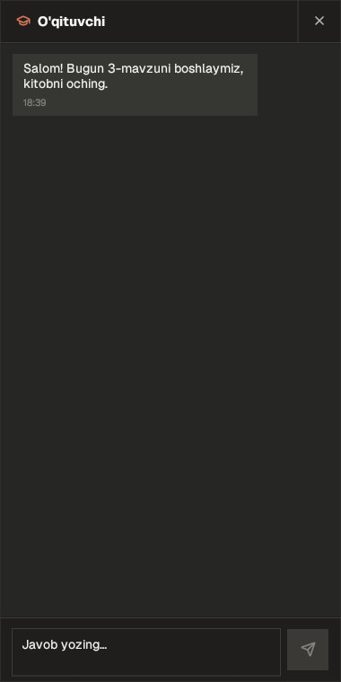

# Vimora

**Kompyuter xonalarini boshqarish uchun bepul va ochiq dastur.** NetSupport School va Veyon'ga
muqobil. O'qituvchi bitta kompyuterdan sinfdagi barcha kompyuterlarni ko'radi va boshqaradi.

Rust'da yozilgan, tez ishlaydi. **Windows** va **Ubuntu** uchun.



---

## Nima qila oladi

| | |
|---|---|
| 🖥 **Kuzatish** | Barcha ekranlar bir joyda (katakcha yoki ro'yxat ko'rinishi), bittasini katta ochish |
| 🖱 **Boshqarish** | O'quvchi kompyuterini masofadan sichqoncha va klaviatura bilan boshqarish |
| 🔒 **Qulflash** | Dars vaqtida ekranni qulflash — o'quvchi chalg'imaydi |
| 📽 **Namoyish** | O'qituvchi ekranini hamma o'quvchilarga ko'rsatish |
| 💬 **Xabarlar** | Telegram'ga o'xshash chat — o'quvchi javob yoza oladi |
| 🌐 **Internet** | Saytlarni bloklash, taqiqlangan so'zlarni qidirishni to'xtatish, xavfsiz qidiruv |
| 🚫 **Dasturlar** | Keraksiz dasturlarni bloklash, sayt yoki dasturni masofadan ochish, fayl yuborish |
| ❄️ **Shadow rejim** | Qayta yuklanganda kompyuter "yangidek" bo'lib yonadi (Shadow Defender / Deep Freeze kabi) |
| ⬇️ **Yangilanishlar** | Windows Update va dasturlar yangilanishini o'qituvchi kompyuteridan boshqarish |
| ⚡ **Quvvat** | O'chirish, qayta yoqish, seansdan chiqarish |
| 🏫 **Xonalar** | Kompyuterlarni xonalarga ajratish, nomini o'zgartirish |

Uch til (o'zbek, ingliz, rus), sichqoncha bilan belgilash (File Explorer kabi), qorong'i va yorug' mavzu, avtomatik yangilanish.

| Yorug' mavzu | Ro'yxat ko'rinishi |
|---|---|
|  |  |

| Shadow rejim | Chat (o'qituvchi) | Chat (o'quvchi) |
|---|---|---|
|  |  |  |

---

## Qanday ishlaydi

Ikki qism bor:

- **`vimora-server`** — o'qituvchi kompyuteridagi konsol.
- **`vimora-client`** — har bir o'quvchi kompyuteridagi agent.

Hech narsa sozlash shart emas: o'rnatsangiz bas. O'quvchi kompyuterlari konsolni tarmoqda
(Wi-Fi yoki LAN) o'zi topadi va konsolda paydo bo'ladi — xonalarga o'qituvchi o'zi taqsimlaydi.

Har bir kompyuter **birinchi topgan konsoliga bog'lanadi** va keyin faqat unga bo'ysunadi —
boshqa kompyuterda ochilgan konsol uni boshqara olmaydi. Konsolni almashtirish kerak bo'lsa,
o'quvchi kompyuterida administrator sifatida `vimora-client unpair` ni ishga tushiring.

---

## O'rnatish

Tayyor o'rnatuvchilarni **[Releases](https://github.com/veymay/vimora/releases/latest)** sahifasidan yuklab oling:

| Kompyuter | Windows | Ubuntu |
|---|---|---|
| O'qituvchi | `vimora-…-windows-x64-setup.exe` → **O'qituvchi** | `vimora-teacher_…_amd64.deb` |
| O'quvchi | `vimora-…-windows-x64-setup.exe` → **O'quvchi** | `vimora-student_…_amd64.deb` |

Ubuntu'da:

```bash
sudo apt install ./vimora-student_*_amd64.deb
```

O'quvchi paketi ekranni ko'rish uchun X11 seansini yoqadi — o'rnatgandan keyin kompyuterni qayta yoqing.

### Yangilanish

Vimora o'zini **GitHub Releases'dan o'zi yangilaydi**. Har bir yuklab olingan fayl `SHA256SUMS`
bilan tekshiriladi.

- **O'quvchi kompyuterlari** har 6 soatda yangi versiyani tekshiradi va so'rovsiz o'rnatadi
  (Shadow yoqilgan kompyuterlar o'tkazib yuboriladi). Sozlamalar → O'quvchi kompyuterlari'da
  o'chirib qo'yish yoki "Hozir yangilash" mumkin.
- **Konsol** yangi versiya chiqqanini ko'rsatadi; o'rnatish — Sozlamalar → Yangilanish → "O'rnatish".

### Sozlamalar

Til (**O'zbekcha, English, Русский**), mavzu (qorong'i / yorug' / tizim), kartochka o'lchami
(100–200%), tartiblash, qulf ekrani matni va boshqalar. O'zgarishlar darhol saqlanadi.

### O'zingiz yig'ish

```powershell
powershell -ExecutionPolicy Bypass -File installer\windows\build.ps1     # Windows → dist\*.exe
```

```bash
cargo install cargo-deb
cargo build --release && cargo deb -p vimora-server --no-build && cargo deb -p vimora-client --no-build
```

---

## Ishlab chiquvchilar uchun

[Rust](https://rustup.rs) kerak. Linux'da qo'shimcha paket shart emas.

```bash
cargo run -p vimora-server                                 # konsol
cargo run -p vimora-client -- --server 127.0.0.1:47801     # agent (sinov uchun)
cargo test --workspace
```

```
crates/vimora-core   protokol, imzolangan ulanish, ekran olish
crates/vimora-ui     dizayn: ranglar, shriftlar, ikonlar, tarjimalar
crates/vimora-update GitHub Releases'dan o'zini yangilash
apps/vimora-server   o'qituvchi konsoli
apps/vimora-client   o'quvchi agenti + Vimora xizmati (Shadow, yangilanishlar, internet)
installer/           Windows va Ubuntu o'rnatuvchilari
```

---

## Bilish kerak

- **Shadow rejim** Windows'da faqat **Enterprise** yoki **Education** nashrida ishlaydi
  (Home/Pro'da UWF yo'q). Ubuntu'da `overlayroot` orqali ishlaydi.
- Ubuntu'da ekranni ko'rish va boshqarish **X11** seansida ishlaydi (Wayland'da emas). O'rnatuvchi buni sozlab beradi.
- Buyruqlar konsol imzosi bilan tekshiriladi, lekin trafik shifrlanmaydi — faqat ishonchli lokal tarmoqda ishlating.
- Portlar: o'qituvchi — **TCP 47801**, o'quvchi — **UDP 47800**. O'rnatuvchilar firewall'ni o'zi sozlaydi.
- Loyiha yangi: real sinfda sinab ko'rilmoqda. Xato topsangiz, [Issue](https://github.com/veymay/vimora/issues) oching.

---

## Litsenziya

[MIT](LICENSE) — bepul foydalaning, o'zgartiring, tarqating.

Ikonlar: [Lucide](https://lucide.dev) (ISC). Shriftlar: [Geist](https://vercel.com/font) (OFL).
